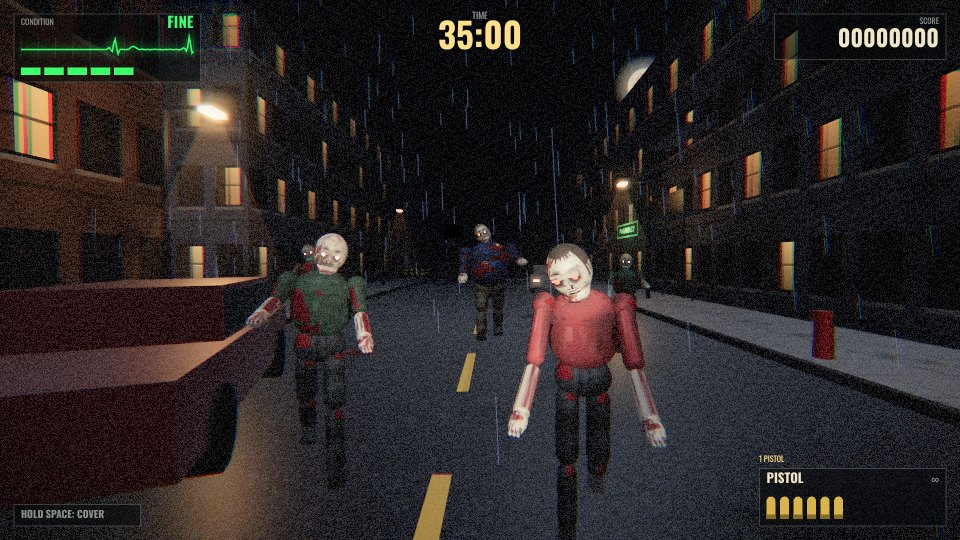

# GRAVE SHIFT



A browser zombie **rail shooter** in the spirit of the classic arcade light-gun games: the camera moves you through the level on rails while you aim and shoot with the mouse. It combines three influences:

- **Rail shooting and dismemberment** (House of the Dead style): headshots, severed limbs, survivors to rescue, bosses with glowing weak points
- **Cover and a countdown timer** (Time Crisis style): hold a key to duck behind cover, reload, and dodge attacks while a timer counts down
- **Survival horror atmosphere** (Resident Evil style): a flashlight, an ECG "condition" health monitor, green herbs, and a creepy hospital and underground lab

The look aims for the PS2/PS3 era: smooth characters, real-time flashlight shadows, bloom, wet reflective streets, fake light shafts and a film-grain color grade. Everything is generated in code: textures are painted on canvases, sounds and music are synthesized with the Web Audio API, and there are no image or audio files.

## Play

Open `index.html` in a modern desktop browser (Chrome, Edge, Firefox or Safari). No server or install needed; the game is pre-built into `dist/game.js`.

To play it online, enable **GitHub Pages** for this repo (Settings → Pages → Deploy from a branch → pick the branch and `/ (root)`), then open the Pages URL.

## Controls

| Action | Mouse / keyboard | Touch |
| --- | --- | --- |
| Aim | Move the mouse | Tap where you want to shoot |
| Shoot | Left click (hold for SMG) | Tap |
| Reload | Right click or `R` | RELOAD button |
| Take cover (reloads all weapons, blocks attacks) | Hold `Space` (or `Shift` / `C`) | Hold the COVER button |
| Switch weapon | `1`–`4`, mouse wheel, `Q` / `E` | WEAPON button |
| Pause / mute | `Esc` / `M` | ❚❚ button |

## How to play

- **Headshots** kill instantly. Body shots knock zombies back; arm and leg shots can **sever limbs** (a zombie that loses a leg will crawl).
- A zombie that **flashes red** with a **"!"** marker over it is about to hit you. Shoot it to interrupt the attack, or take cover.
- **Thrown objects** (bottles, cleavers, acid) can be shot out of the air.
- **Survivors**: kill the zombies chasing them to earn an extra life. Don't shoot the survivors.
- **Crates** hold green herbs (+1 life) and weapons: shotgun, SMG and magnum. **Red barrels** explode.
- In fights, the **TIME** counter runs down. If it reaches zero, you lose a life.
- Each boss has a **glowing weak point**. Shooting anything else barely hurts it.
- When you run out of lives you can continue, but your credits used are shown on your score.

## The campaign

1. **Nightfall** — rain-soaked downtown streets. Boss: *The Butcher*.
2. **Mercy General** — a hospital overrun by its own patients. Boss: *The Warden*.
3. **Sublevel 4** — the underground lab where it began. Boss: *Subject Zero*.

## Development

```bash
npm install
```

```bash
npm run dev
```

`npm run dev` rebuilds on change and serves the game at http://localhost:8000.

```bash
npm run build
```

`npm run build` writes the minified bundle to `dist/game.js`. Commit it, since `index.html` loads it directly.

### Project layout

| File | What it does |
| --- | --- |
| `src/game.js` | Renderer and post-processing, game state machine, scoring, the player |
| `src/director.js` | The "rail": runs each stage's scripted beats (camera moves, fights, bosses) |
| `src/stages.js` | Level geometry and beat scripts for the three chapters |
| `src/entities.js` | Zombies (6 types) and their AI, survivors, projectiles, pickups, barrels, crates |
| `src/bosses.js` | The three bosses |
| `src/rig.js` | Procedurally animated humanoid models and outfits |
| `src/weapons.js` | Hitscan weapons, reloading, cover reload |
| `src/builder.js` | Level construction kit: materials, batching, props |
| `src/effects.js` | Particles, blood decals, debris, fire, rain, pooled dynamic lights |
| `src/textures.js` | Procedurally painted canvas textures |
| `src/audio.js` | Synthesized sound effects and step-sequenced music |
| `src/hud.js` | Crosshair, health monitor, ammo, timer, boss bar, blood on screen |

### Debug URL parameters

| Parameter | Effect |
| --- | --- |
| `?stage=1` | Start at a given stage (0-based) |
| `?beat=5` | Start at a given beat within the stage |
| `?god` | Player can't die |
| `?bot` | Autoplay: the game aims and shoots by itself (used for testing) |
| `?quality=low` | Force low graphics (no shadows, bloom or MSAA) |
| `?norender&speed=6` | Skip rendering and run the simulation 6× faster (for automated test runs with `?bot&god`) |

Example: `index.html?stage=2&beat=10&god` jumps to the final boss.
